<h1 data-importer="text" align="center">Hey 👋What's Up?</h1>

###

  
  
  
  
  
  
  
  
  
  
  
  
  
  
  
  
  
  
  
  
  
  
  
  
  
  
  
  
  

###

  
  
  
  
  

###

  
  

###

  <picture>
    <source
      media="(prefers-color-scheme: dark)"
      srcset="https://raw.githubusercontent.com/aadityamishra32612-code/aadityamishra32612-code/output/pacman-contribution-graph-dark.svg"
    />
    <source
      media="(prefers-color-scheme: light)"
      srcset="https://raw.githubusercontent.com/aadityamishra32612-code/aadityamishra32612-code/output/pacman-contribution-graph.svg"
    />
    
  </picture>

###
